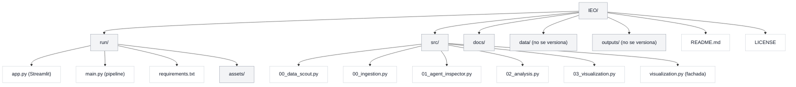
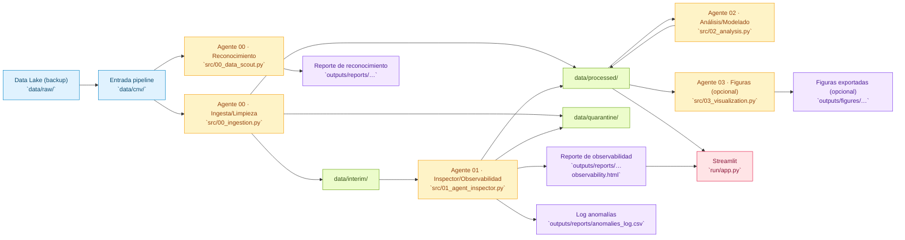

# IEO Orchestrator — Pipeline y Visualización de Series Temporales Oceanográficas

> **Trabajo de Fin de Máster** | Pipeline de datos y plataforma web interactiva para el análisis de radiales oceanográficos del IEO (Instituto Español de Oceanografía).

---

## ¿Qué hace este proyecto?

Diseña e implementa un **pipeline integral de datos** (ingesta, validación de calidad, análisis estadístico) y una **plataforma web interactiva** (Streamlit) para explorar series temporales históricas de muestreos marinos.

La arquitectura prioriza **automatización**, **reproducibilidad**, **control de calidad riguroso del dato** y su accesibilidad a través de visualizaciones interactivas.

---

## 🏗️ Estructura del Proyecto

```text
IEO-Orchestrator/
├── data/                      ← Ciclo de vida de los datos (ver nota ↓)
│   ├── raw/                   Backup de ficheros crudos del CTD (no se procesa automáticamente)
│   ├── cnv/                   Punto de entrada del pipeline (ficheros `.cnv` listos para procesar)
│   ├── interim/               Archivos temporales generados al unificar formatos
│   ├── processed/             Datos finales limpios y validados
│   ├── quarantine/            Registros marcados por el inspector ML
│   └── pending_review/        Datos pendientes de revisión manual
├── src/                       ← Lógica de backend y análisis
│   ├── 00_data_scout.py       Reconocimiento y reporte de datos en raw/
│   ├── 00_ingestion.py        Estandarización y limpieza estructural
│   ├── 01_agent_inspector.py  Auditoría de calidad y observabilidad
│   ├── 02_analysis.py         Cálculos, estadística y modelado
│   ├── 03_visualization.py    Generación de gráficos estáticos
│   ├── visualization.py       Fachada de importación para app.py
│   └── fig_export.py          Exportación de figuras a PNG
├── outputs/                   ← Productos generados por los scripts
│   ├── figures/               Gráficos generados (PNG)
│   └── reports/               Informes de validación de calidad
├── docs/                      ← Documentación y contenido editorial
│   ├── metodologia_*.md       Textos metodológicos (cargados por la web)
│   ├── data_dictionary.yaml   Diccionario de variables procesadas
│   └── descripcion_Radiales.txt
├── run/                       ← Artefactos de ejecución (CLI + web)
│   ├── app.py                 Frontend (Streamlit) — plataforma web interactiva
│   ├── main.py                Orquestador — ejecuta el pipeline completo
│   ├── lanzador.bat           Script de arranque rápido para Windows
│   ├── requirements.txt       Dependencias Python
│   ├── assets/                Logo y recursos de la interfaz web
│   └── README.md              Guía rápida de uso de `run/`
└── README.md
```

> [!IMPORTANT]
> **Las carpetas `data/` y `outputs/` están vacías** (solo contienen un `.gitkeep`).
> Para iniciar el pipeline, coloca los ficheros **`.cnv`** en `data/cnv/` y ejecuta `python run/main.py` (o `cd run && python main.py`).
> `data/raw/` se usa como **copia de seguridad** de los ficheros crudos (p.ej. `.hex/.xmlcon/.hdr/.bl`) por trazabilidad.

## ✅ Esquema operativo (entrada: ficheros `.cnv`)

**Premisa de alcance:** la conversión desde los ficheros **crudos del CTD** (p. ej. `.hex` / `.xmlcon`) hasta **salida Sea-Bird lista (`*.cnv`)** la realiza **personal técnico** con las herramientas corporativas habituales. **Este repositorio no sustituye ese paso**: asume que ya dispones de **`.cnv` válidos**.

**Qué hace este proyecto con los `.cnv`:**

1. **Copiar** los ficheros **`<CAST>.cnv`** en **`data/cnv/`** (único punto de entrada automático del pipeline y del visor Radiales Gijón).
2. **(Opcional)** Copia de seguridad de crudos en `data/raw/` solo por trazabilidad documental; **no** se procesan solos.
3. **Ejecutar el pipeline IEO** (normalización canónica, contrato de datos, anomalías, reportes en `outputs/runs/<run_id>/`):

```bash
python run/main.py
```

4. **Lanzar Streamlit** (visor; prioriza **`data/cnv/*.cnv`**):

```bash
cd run
streamlit run app.py
```

Si no hay `.cnv` en `data/cnv/`, el visor puede recurrir al CSV legado `data/processed/sireno_gijon_ctd_processed.csv`. Detalle en **`run/README.md`**.

### Automatización opcional (solo desarrollo / CI)

Para convertir `.hex`→`.cnv` **sin sustituir al técnico**, existe una ruta opcional con `DatCnvW` + `run/ieo_cli.py convert-cnv` — véase `tools/seabird/README.md` y `docs/flujo_cnv_seabird_y_automatizacion.md`.

### Contrato de datos (visor + pipeline)

Reglas de rangos y deriva temporal sobre perfiles y series mensuales: **`docs/contrato_datos_radiales.md`** (implementación en `src/ieo/validation/`).

> Nota histórica: conversión Sea-Bird → `.cnv` en laboratorio: `docs/flujo_cnv_seabird_y_automatizacion.md`.

### Diagrama (alto nivel, sin datos sensibles)



---

## ⚙️ Flujo de Trabajo

```
data/cnv/  →  00_data_scout.py  →  00_ingestion.py  →  01_agent_inspector.py
                                                              ↓
                                         data/processed/  +  data/quarantine/
                                                              ↓
                                                     run/app.py (Streamlit)
```

### Diagrama de flujo de información (alto nivel)



1. **Reconocimiento** (`00_data_scout.py`): genera un reporte de la estructura del raw antes de procesar nada.
2. **Ingesta** (`00_ingestion.py`): estandariza formatos irregulares y produce un CSV tabular limpio.
3. **Inspección** (`01_agent_inspector.py`): audita la calidad física/biológica del dato; los registros anómalos van a `quarantine/`.
4. **Análisis y visualización** (`02_analysis.py`, `03_visualization.py`): estadísticas, tendencias y gráficos a disco.
5. **Plataforma web** (`run/app.py`): interfaz Streamlit para exploración interactiva de los datos validados.

---

## 🚀 Instalación y Arranque

### 1. Entorno Python

```bash
cd run
# Python 3.11 o 3.12 recomendado
pip install -r requirements.txt
```

### 2. Datos

Coloca los ficheros **`.cnv`** (y opcionalmente `.xls/.xlsx` / `.nc`) en `data/cnv/`.
> ⚠️ Los datos reales del IEO **no se incluyen** en este repositorio.

### 3. Ejecutar el pipeline IEO (opcional)

Lee `data/cnv/` y escribe Parquet + reportes en `outputs/runs/<run_id>/`.

```bash
cd run
python main.py
```

### 4. Lanzar la plataforma web (Streamlit)

```bash
cd run
streamlit run app.py
```

O desde la raíz del repo: `streamlit run run/app.py`.

En Windows puedes usar `run/lanzador.bat` (instala dependencias y abre Streamlit; **no** ejecuta `main.py`).

**Radiales Gijón (gráficos):** el visor usa **`data/cnv/*.cnv`** (temperatura a 5 m + ATAC). Sin `.cnv`, intenta el CSV legado `data/processed/sireno_gijon_ctd_processed.csv`. Orden completo: **`run/README.md`**.

---

## 🛠️ Stack Tecnológico

| Capa | Tecnologías |
|---|---|
| Orquestación e ingesta | Python, Pandas, Pathlib |
| Calidad de datos | Great Expectations |
| Visualización estática | Plotly, Seaborn, Matplotlib |
| Plataforma web | Streamlit |

---

## 📁 Notas

- Los textos metodológicos se editan en `docs/metodologia_*.md` y la web los carga automáticamente.
- `src/archive/` contiene módulos en desarrollo no activos en el pipeline principal. No se incluye en el repositorio.
- La carpeta `auditoria_advicExplorer/` (análisis de la aplicación R Shiny adviceXplorer del ICES) se mantiene localmente y no forma parte de este repositorio.
